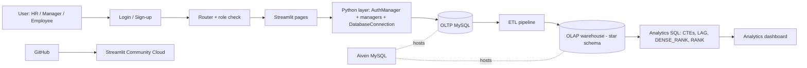

# Enterprise Employee Analytics

An end-to-end employee data platform. HR and managers sign in to a **Streamlit** web app, enter operational data (employees, projects, assignments, performance reviews) into a normalized **OLTP MySQL** database, and an **ETL pipeline + stored procedures** move that data into a **star-schema data warehouse (OLAP)** that keeps employee history with **SCD Type 2**. An interactive dashboard built on **SQL window functions and CTEs** analyses performance, attrition risk and project bottlenecks. Employees get their own self-service profile page.

Access is controlled by **role-based login (HR / Manager / Employee)**, with salted PBKDF2 password hashing. Both databases are hosted on **Aiven MySQL** and the app is deployed on **Streamlit Community Cloud**.

**Live app:** https://enterprise-employee-analyticsfinal-fezpmjni2cruxyezl9vfva.streamlit.app/

> The database runs on a free cloud plan that sleeps when idle. If the app shows **"Down"** or takes a while to load, wait a minute and open it again.

## Business problem

Employee information sits in operational tables, so it is hard to compare performance across years, to see who may leave, and to notice when people are over-allocated on projects. The warehouse and dashboard give HR and managers one trusted place for reporting and analytics, while role-based access keeps salary and personal data limited to the people who need it.

---

## Features

| Area | What you can do |
|---|---|
| **Sign in / sign up** | Sign in with email and password. New employees can create an account themselves (Employee role only). |
| **Employees (HR)** | Onboard employees (name, email, department, role, level, salary, etc.), update department / role / level / salary (**SCD Type 2**), search the directory, delete an employee that has no reviews or assignments |
| **Employee Directory (Manager)** | Read-only search by employee ID, name or email, with a department filter. Shows ID, name, email, department, role, level and Active / Left status. **Salary, age, gender and ratings are deliberately not shown.** |
| **Projects (Manager)** | Create projects, assign employees with a role and allocation %, view project teams. A warning appears when an employee's total allocation goes above 100%. |
| **Reviews (HR, Manager)** | Submit a 1-5 rating with comments for any employee, view review history |
| **Analytics (HR, Manager)** | Year-over-year performance (`LAG()`), top performers per department (`DENSE_RANK()`), attrition risk scoring, project bottlenecks (`RANK()`), with department / top-N / year filters |
| **My Profile (Employee)** | See your own details, projects, reviews and full career history (every SCD Type 2 version). You can never see another employee's data. |
| **Home** | Database connection status (OLTP and OLAP), company KPIs and a guide to the pages your role can open |

Every save runs as **one transaction**: write to the OLTP database, sync the warehouse with a stored procedure, then commit (or roll everything back), so the two databases never disagree.

---

## Roles, pages and demo accounts

### Who can open what

| Page | HR | Manager | Employee |
|---|:-:|:-:|:-:|
| Home | ✅ | ✅ | ✅ (welcome message only) |
| Onboarding (add / update / delete employees) | ✅ | | |
| Employee Directory (read-only) | | ✅ | |
| Projects | | ✅ | |
| Reviews | ✅ | ✅ | |
| Analytics | ✅ | ✅ | |
| My Profile | | | ✅ |

The table comes straight from `PAGE_ACCESS` in `app/auth.py`. To change who can see a page, edit that dictionary.

### Demo accounts

`sql/10_app_users.sql` creates four demo logins. **Password for all of them: `Demo@123`**

| Email | Role | Sees |
|---|---|---|
| `hr@company.com` | HR | Home, Onboarding, Reviews, Analytics |
| `manager@company.com` | Manager | Home, Employee Directory, Projects, Reviews, Analytics |
| `employee1@company.com` | Employee | Home, My Profile (employee #1) |
| `employee2@company.com` | Employee | Home, My Profile (employee #2) |

> For a real or public deployment, change these passwords (or delete the accounts) and set `SHOW_DEMO_LOGINS = "0"` so the demo box is hidden on the login page. See [Configuration](#configuration).

---

## Architecture



### Write path (saving data)

1. A user submits a Streamlit form (only on a page their role can open).
2. The entity class (`Employee`, `Project`, `Review`) validates the input.
3. A manager class opens **one database transaction**, writes to the OLTP tables and calls a warehouse stored procedure.
4. If every step succeeds the transaction commits; if any step fails, everything is rolled back.

### Read path (analytics)

The ETL pipeline loads OLTP data into the warehouse. The dashboard calls `AnalyticsManager`, which runs SQL against the **star schema only**, and Plotly draws the charts. Query results are cached for a few minutes and the cache is cleared after every write.

### Login path

1. The login form calls `AuthManager.authenticate(email, password)`.
2. On success the user dictionary (`user_id`, `email`, `role`, `display_name`, `employee_number`) is stored in `st.session_state["user"]`.
3. The router (`streamlit_app.py`) builds the sidebar from `PAGE_ACCESS[role]`, so pages a role cannot open do not exist for that session.
4. **Log out** clears the session state.

---

## Authentication and access control

| Topic | How it works |
|---|---|
| **Password storage** | Never stored in plain text. Format: `pbkdf2_sha256$200000$<salt>$<hash>` (HMAC-SHA256, 200,000 iterations, 16-byte random salt per user). |
| **Password check** | `hmac.compare_digest` (constant time). For an unknown email a dummy hash is verified so the response time does not reveal whether the email exists. |
| **Self sign-up** | Always creates an **Employee** login (`SIGNUP_ROLE`). Name 2-150 characters, valid email, password of at least 8 characters containing a letter and a number, matching confirmation. Duplicate emails are rejected, including two people signing up at the same moment. |
| **HR / Manager accounts** | Cannot be created from the sign-up page. They are created by an administrator (see [Managing user accounts](#managing-user-accounts)). |
| **Linking a login to an employee record** | If an `Employee` row has **exactly** the same email, and no other login is already linked to it, the new login is linked to it automatically. Nothing is guessed from names. If there is no safe match the login stays unlinked and **no employee record is created**. |
| **My Profile identity** | Decided on the server from the `AppUser` row (found by the `user_id` stored at login). It never comes from the URL, a form field or anything the browser could change, so an employee can only open their own record. Unlinked accounts see a clear message and no data. |
| **Second line of defence** | The router hides pages a role cannot open, and the Onboarding and Employee Directory pages also call `require_roles(...)` before showing anything. |
| **SQL injection** | All values are passed as query parameters, never concatenated into SQL. |
| **Secrets** | Database passwords live only in `.env` (git-ignored) or Streamlit Secrets. |

---

## Tech stack

Python 3.11+, pandas, Faker, MySQL 8 (stored procedures, CTEs, window functions), mysql-connector-python, Streamlit, Plotly, python-dotenv, pytest, Git/GitHub, MySQL Workbench, Aiven MySQL, Streamlit Community Cloud.

Pinned versions are in `requirements.txt` (`mysql-connector-python`, `pandas`, `python-dotenv`, `streamlit`, `plotly`, `Faker`).

---

## Repository structure

```
app/                          Streamlit app and OOP backend
  streamlit_app.py              entry point and page router (role-based navigation)
  login.py                      sign-in page
  signup.py                     employee self sign-up page
  auth.py                       password hashing, AuthManager, PAGE_ACCESS (role -> pages)
  db_manager.py                 DatabaseConnection (Singleton, thread-safe, transactions)
  entities.py                   Employee, Project, Review (validated attributes)
  managers.py                   EmployeeManager, ProjectManager, ReviewManager (OLTP),
                                AnalyticsManager (OLAP)
  ui_helpers.py                 shared helpers: page_setup, current_user, require_roles, cached lookups
  pages/
    0_Home.py                   connection status, KPIs, page guide
    1_Onboarding.py             HR: onboard / update (SCD Type 2) / delete / search employees
    2_Projects.py               Manager: create projects, assign employees, view teams
    3_Reviews.py                HR + Manager: submit and list performance reviews
    4_Analytics.py              HR + Manager: four analyses with filters
    5_My_Profile.py             Employee: own details, projects, reviews, career history
    6_Employee_Directory.py     Manager: read-only employee lookup
python/                       data_synthesizer.py, inspect_dataset.py,
                              validate_synthetic_data.py, etl_pipeline.py
sql/                          01_olap_ddl, 02_olap_dml, 03_stored_procedures, 04_cte_queries,
                              05_window_functions, 06_app_support, 07_seed_demo_data,
                              08_aiven_setup, 09_add_employee_email, 10_app_users,
                              11_link_app_user_to_employee, schema (OLTP)
data/                         IBM HR dataset + synthesized CSVs
diagrams/                     ER diagram, dimensional model, architecture (Workbench / draw.io)
docs/                         project documentation (Word) and presentation
tests/                        smoke_test.py (database integration) + pytest suite (mocked)
.env.example                  template for local settings
.streamlit/secrets.toml.example   template for Streamlit Cloud secrets
requirements.txt
```

---

## Data model

### OLTP (normalized)

| Table | Role |
|---|---|
| `Department`, `JobRole`, `EducationField` | Lookup tables (3, 9 and 6 rows) |
| `Employee` | Main entity, 100,000 rows. Includes a unique, nullable `email` column |
| `Project` | Projects with department, dates and status |
| `Assignment` | Many-to-many link between employees and projects (role, allocation %) |
| `Reviews` | Performance reviews (date, period, 1-5 rating, comments) |
| `employee_scd_history` | Version history of employees (department, role, level, income, dates, `is_current`) |
| `AppUser` | **Logins:** `user_id`, unique `email`, `password_hash`, `role` (`HR` / `Manager` / `Employee`), `display_name`, optional `employee_number`, `is_active`, `created_at` |

Primary and foreign keys enforce integrity. The ER diagram is in `diagrams/` (MySQL Workbench). It was drawn before `AppUser` and `Employee.email` were added, so refer to the table above for those.

### OLAP (star schema)

| Type | Tables |
|---|---|
| Dimensions | `DimEmployee` (SCD Type 2), `DimDepartment`, `DimJobRole`, `DimEducationField`, `DimProject`, `DimDate` |
| Facts | `FactEmployee`, `FactAssignment`, `FactReview` |

All dimensions use **surrogate keys**; `employee_number` is the natural key from the source system. Because one employee can have several versions, `employee_number` is **not** unique in `DimEmployee`; each version has its own `employee_key`, and fact rows point to the version that was valid for them.

### SCD Type 2 in one picture

`DimEmployee` keeps history with `effective_start_date`, `effective_end_date` and `is_current`, so a department or salary change closes the old row and opens a new one instead of overwriting it.

| employee_key | department | job_level | monthly_income | start | end | is_current |
|---|---|---|---|---|---|---|
| 110004 | Sales | 2 | 6000 | 2025-01-01 | 2026-10-03 | 0 |
| 110005 | Research & Development | 3 | 7500 | 2026-10-04 | NULL | 1 |

*(illustrative example of one employee's two versions)*

When HR saves a change of department, job role, job level or monthly income, `EmployeeManager.update_employee` runs one transaction that:

1. updates the `Employee` table,
2. closes the current row in `employee_scd_history` (or creates the baseline row first if the employee had no history) and inserts the new current row,
3. calls the stored procedure `sp_scd2_update_employee`, which
   - finds the current row (`employee_number = X AND is_current = 1`),
   - does nothing if no tracked attribute really changed,
   - closes the old row (`effective_end_date = new start - 1 day`, `is_current = 0`),
   - inserts the new version with a new surrogate key,
   - inserts a `FactEmployee` row for the new version.

A review is attached to the employee version that was valid on the review date (`sp_sync_review`), so year-over-year results by department stay correct even after an employee moves.

**Verified warehouse load:** `DimDepartment` 3, `DimJobRole` 9, `DimEducationField` 6, `DimProject` 30, `DimDate` 1,096 (later extended to the end of 2027), `DimEmployee` 110,000 (100,000 current + 10,000 historical), `FactEmployee` 100,000, `FactAssignment` 26,508, `FactReview` 104,945.

---

## Data synthesis

`python/data_synthesizer.py` (`EmployeeDataSynthesizer`) scales the public 1,470-row **IBM HR Analytics Employee Attrition and Performance** dataset to **100,000 employees** using pandas and Faker. Each employee starts from a randomly chosen real row and receives a new employee number, a fake first and last name and an email address of the form `first.last<id>@company.com`.

Because the dataset is a single snapshot with no history, the script also creates historical records for **10% of employees (10,000)**: an older version valid from 2023-01-01 to 2024-12-31 (85-95% of the current salary, sometimes a lower job level or a different department) and a current version from 2025-01-01. That gives **20,000 history rows** and makes SCD Type 2 meaningful. The CSV files are loaded into a staging table and then into the OLTP tables.

Because synthetic emails follow a predictable pattern, a new person who signs up with the exact email of an existing employee record is linked to that record automatically.

---

## ETL

`python/etl_pipeline.py` (plus `sql/02_olap_dml.sql` and `sql/06_app_support.sql`) follows Extract, Transform, Load:

- **Extract** employees, history, projects, assignments and reviews from OLTP into pandas.
- **Transform:** remove duplicate records and records with missing mandatory identifiers (the verified run removed 0 of each), compare incoming employees with `DimEmployee` and classify them as new, changed or unchanged (only new or changed employees create rows), and look up surrogate keys and date keys for the facts.
- **Load** the dimensions first (department, job role, education field, project, date, employee), then the fact tables, because facts need the dimension keys.
- **Re-runnable:** simple dimensions use unique constraints so they load without duplicates, and the fact tables are cleared and reloaded. Because the history table is updated in the same transaction as the application's changes, re-running the ETL reproduces the same versions and never loses a change made in the app.

---

## Analytics

| Analysis | Technique |
|---|---|
| **Year-over-year performance** | A CTE averages review ratings per year and department (using the department *at the time of the review*); `LAG(avg_rating) OVER (PARTITION BY department_name ORDER BY review_year)` gives the previous year, the difference is the change |
| **Top performers** | `DENSE_RANK() OVER (PARTITION BY department_name ORDER BY avg_rating DESC, review_count DESC, performance_rating DESC, monthly_income DESC)`; ties share a rank, no gaps; dashboard shows ranks up to a chosen N |
| **Attrition risk** | CTE risk score 0-8 for current employees who have not left (table below) |
| **Project bottlenecks** | One CTE totals each employee's allocation across all projects (above 100% = over-allocated); a second counts team size, average allocation and over-allocated members per project; `RANK()` orders projects by over-allocated members |

**Attrition risk score** (one point per condition):

| Factor | Rule |
|---|---|
| Overtime | `overtime = Yes` |
| Low job satisfaction | `job_satisfaction <= 2` |
| Poor work-life balance | `work_life_balance <= 2` |
| Low environment satisfaction | `environment_satisfaction <= 2` |
| No promotion for years | `years_since_last_promotion >= 5` |
| Long commute | `distance_from_home >= 20` |
| Underpaid | `monthly_income` below 80% of the department average |
| Short tenure | `years_at_company <= 2` |

Bands: **High** = 5 or more, **Medium** = 3-4, **Low** = 0-2. The dashboard also shows attrition rate by department and by job role, and a list of the highest-risk employees.

---

## Python backend design

| Class (file) | Role |
|---|---|
| `DatabaseConnection` (`db_manager.py`) | Singleton: one shared, thread-safe MySQL connection per class. `query`, `query_df`, `execute`, `transaction` (commit or rollback), `test_connection`. Reads settings from environment variables, a `.env` file or Streamlit Secrets. |
| `AuthManager` (`auth.py`) | Login (`authenticate`), account creation (`create_user`, `sign_up`), duplicate check (`email_exists`), safe email-based linking (`linkable_employee_number`, `find_employee_for_user`). Uses the OLTP database. |
| `EmployeeManager` (`managers.py`) | Employee CRUD, lookups, read-only `list_directory`, SCD Type 2 update, version history, delete only when the employee has no reviews or assignments |
| `ProjectManager` | Create projects, assign employees (duplicate assignments rejected), list teams, total allocation |
| `ReviewManager` | Save and list reviews, then sync them to the warehouse |
| `AnalyticsManager` | OLAP: company KPIs and the four analyses (read only) |
| `Employee`, `Project`, `Review` (`entities.py`) | Entities with private attributes and validating properties |

Design points:

- All managers inherit from `DatabaseConnection` and each is its own Singleton. OLTP managers and `AuthManager` use the OLTP database; `AnalyticsManager` uses the warehouse.
- Entity classes validate every input before it reaches the database: person names accept letters only (spaces, hyphens and apostrophes inside a name), **email must look like `name@domain.tld`**, ages 18 to 70, ratings 1 to 5, project names and project roles reject special characters, review dates cannot go past 2027-12-31 (the end of `DimDate`).
- Invalid input raises `ValueError`; database problems are raised as a single `DatabaseError` type that the pages display.
- A re-entrant lock protects the shared connection because Streamlit serves each user in its own thread.

---

## Run it locally

Requirements: Python 3.11+, MySQL 8, Git (MySQL Workbench is helpful).

```bash
git clone https://github.com/Shravani-A-Kulkarni/Enterprise-Employee-Analytics.git
cd Enterprise-Employee-Analytics
python -m venv .venv
.venv\Scripts\activate            # macOS/Linux: source .venv/bin/activate
pip install -r requirements.txt
cp .env.example .env              # Windows: copy .env.example .env  (then fill in your MySQL values)
```

Then prepare the databases in MySQL Workbench, **in this order**:

| Step | What to run | Why |
|---|---|---|
| 1 | `sql/schema.sql` | Creates the OLTP database and loads the CSV data (edit the CSV paths inside it for your machine). It already includes the `email` column. |
| 2 | `sql/01_olap_ddl.sql`, then `sql/02_olap_dml.sql` | Creates and loads the warehouse |
| 3 | `sql/07_seed_demo_data.sql` **once** | Adds projects, assignments and reviews, and corrects the overtime column. For speed, first run `CREATE INDEX idx_staging_empno ON employee_staging (EmployeeNumber);` |
| 4 | `sql/06_app_support.sql` | Creates the application stored procedures and extends `DimDate` to 2027 |
| 5 | `sql/10_app_users.sql` | Creates the `AppUser` login table and the four demo accounts (needs employees 1 and 2 to exist) |
| 6 | `python python/etl_pipeline.py` | Loads the new rows into the warehouse |
| 7 | `python tests/smoke_test.py` | Database check, must end with `ALL CHECKS PASSED` |
| 8 | `streamlit run app/streamlit_app.py` | Opens at http://localhost:8501 |

Notes:

- **Upgrading an existing database?** If your `Employee` table has no `email` column yet, run `sql/09_add_employee_email.sql` once before using the new pages. Old rows get `NULL`, which is fine under the unique index.
- In MySQL Workbench, raise **Edit > Preferences > SQL Editor > DBMS connection read timeout** to 3600 seconds before running the long scripts.
- Sign in with one of the [demo accounts](#demo-accounts) to try each role.

---

## Configuration

Settings are read from environment variables, a `.env` file, or Streamlit Secrets (in that order). The `.env` file is never committed.

| Variable | Meaning |
|---|---|
| `MYSQL_HOST`, `MYSQL_PORT` | Database server address and port |
| `MYSQL_USER`, `MYSQL_PASSWORD` | Database credentials |
| `OLTP_DB` | `enterprise_employee_analytics` |
| `OLAP_DB` | `enterprise_employee_analytics_olap` |
| `MYSQL_SSL_CA` | Path to the CA certificate for hosted MySQL (for example `ca.pem`). Not needed for a local database |
| `SHOW_DEMO_LOGINS` | Optional. `1` (default) shows the demo-accounts box on the login page; set `0` to hide it on a public deployment |

For Streamlit Community Cloud, paste the same names into **App → Settings → Secrets** in TOML format, for example:

```toml
MYSQL_HOST = "your-hosted-mysql-host"
MYSQL_PORT = "3306"
MYSQL_USER = "your_user"
MYSQL_PASSWORD = "your_password"
OLTP_DB = "enterprise_employee_analytics"
OLAP_DB = "enterprise_employee_analytics_olap"
MYSQL_SSL_CA = "ca.pem"
SHOW_DEMO_LOGINS = "0"
```

---

## Managing user accounts

**Employees** can sign up themselves from the login page.

**HR and Manager accounts** cannot be created from the sign-up page (by design). Create them as an administrator, from the `app` folder:

```bash
cd app
python -c "from auth import AuthManager; AuthManager().create_user('jane@company.com', 'StrongPass1', 'Manager', 'Jane Doe')"
```

Use `'HR'`, `'Manager'` or `'Employee'` as the role. The password is hashed before it is saved. (`create_user` needs a working database connection, so make sure `.env` is filled in.)

**Linking an existing login to an employee record.** If an Employee login was created before its employee record existed, it stays unlinked and **My Profile** shows a message. Once HR has onboarded the employee using the same email, **My Profile** finds the record on the person's next visit (it falls back to an exact email match, and shows a note that the link is not saved yet). To save the link permanently, use `sql/11_link_app_user_to_employee.sql`. That script is **manual and optional**: step 1 only lists safe candidates, step 2 links one account (edit the email inside it first), step 3 checks the result. The application never runs it for you.

---

## Deployment

1. **Create the hosted database.** Create a free **Aiven MySQL** service and note its host, port, user and password; download the CA certificate as `ca.pem`.
2. **Move the data.** Export both local databases with MySQL Workbench *Data Export* (leave out the `employee_staging` table and the stored procedures), connect Workbench to Aiven with SSL, and import the file.
3. **Fix names and procedures.** The hosted server runs on Linux, where table names are case-sensitive, while a Windows export contains lowercase names. Run `sql/08_aiven_setup.sql` once on Aiven: it restores the table names (`Employee`, `DimEmployee`, ...) and creates the five application stored procedures.
4. **Add the login features on Aiven.** Run these on the **OLTP** database (`enterprise_employee_analytics`):
   - `sql/09_add_employee_email.sql`, only if the imported `Employee` table has no `email` column yet;
   - `sql/10_app_users.sql`, which creates `AppUser` with the correct capitalisation and the demo accounts.
5. **Test against Aiven.** Put the Aiven values and `MYSQL_SSL_CA=ca.pem` in `.env`, run `python tests/smoke_test.py`, then start the app locally and sign in.
6. **Deploy.** On Streamlit Community Cloud create an app from the GitHub repository (branch `main`, main file `app/streamlit_app.py`) and paste the settings into **Secrets** (TOML above).
7. **Verify.** Open the public URL, sign in as HR, and check that the home page shows **both databases Connected** and that each role sees only its own pages.

Security notes:

- The connection uses SSL with the Aiven CA certificate. `.gitignore` currently lists `ca.pem`, so make sure the certificate file is available to the deployed app (for example commit it with `git add -f ca.pem`; the CA certificate is a public file and safe to commit).
- Passwords exist only in `.env` (git-ignored) and Streamlit Secrets.
- Change the demo-account passwords and set `SHOW_DEMO_LOGINS = "0"` on a public site.
- The Aiven free plan has 1 GB of storage (the project used about 158 MB before the login table was added) and the service sleeps when idle.

---

## Testing

There are two layers of tests.

**1. Pytest suite (mocked, no database required)**: 209 test functions in 12 files:

| File | Covers |
|---|---|
| `test_auth.py` | Password hashing and verification, role-to-page matrix, `authenticate`, `create_user`, sign-up validation, duplicate emails and race, exact-email linking, `find_employee_for_user` |
| `test_login.py`, `test_signup_coverage.py` | Login and sign-up pages (success, invalid input, database error) |
| `test_streamlit_app.py` | Router: login shown when signed out, allowed pages per role |
| `test_my_profile.py` | My Profile: linked account shows own record, unlinked account is blocked |
| `test_employee_directory.py` | Directory search, department filter, hidden sensitive columns, access guard |
| `test_onboarding_coverage.py`, `test_projects_coverage.py` | Onboarding and Projects pages |
| `test_managers.py`, `test_entities.py` | Manager classes and entity validation |
| `test_db_manager.py` | Singleton, connection settings, SSL, transactions, error handling |
| `test_ui_helpers.py` | Shared page helpers (`current_user`, `require_roles`, ...) |

```bash
pip install pytest
python -m pytest tests -q
```

**2. Database smoke test (needs your real databases):** `python tests/smoke_test.py` runs **41 checks** against the real OLTP and OLAP databases and ends with `ALL CHECKS PASSED`. It covers the Singleton and both connections, entity validation, onboarding and warehouse loading, SCD Type 2 (new version, exactly one current row, closed old row, no change means no new version), rollback after a failed update, project creation, assignment (including duplicate rejection), review submission (including invalid ratings), KPIs, year-over-year, top-N, attrition, risk and bottleneck queries.

> The smoke test creates test rows (an employee, a project, an assignment, a review) and may leave them in the database, so do not run it casually against production data.

The deployed app was also tested end to end: sign-in as each role, onboarding, SCD Type 2 update, project creation, assignment, review submission and history, all four analytics tabs, My Profile, Employee Directory, and the connections to both databases on Aiven.

---

## SQL script reference

| Script | Database | Purpose |
|---|---|---|
| `schema.sql` | OLTP | Create the OLTP schema (includes `email`) and load the CSV data |
| `01_olap_ddl.sql` | OLAP | Create the star-schema tables |
| `02_olap_dml.sql` | OLAP | Load dimensions and facts |
| `03_stored_procedures.sql` | OLAP | Three reporting procedures (`sp_attrition_by_department`, `sp_salary_by_job_role`, `sp_performance_summary`) |
| `04_cte_queries.sql`, `05_window_functions.sql` | OLAP | Example CTE and window-function queries |
| `06_app_support.sql` | OLAP | Five application procedures (`sp_scd2_update_employee`, `sp_sync_new_employee`, `sp_sync_project`, `sp_sync_assignment`, `sp_sync_review`) and `DimDate` extension to 2027 |
| `07_seed_demo_data.sql` | OLTP | Demo projects, assignments and reviews; overtime fix. Run once |
| `08_aiven_setup.sql` | Aiven | Restore table-name capitalisation and create the application procedures on the Linux host |
| `09_add_employee_email.sql` | OLTP | Add `Employee.email` (unique, nullable) to an existing database. Run once |
| `10_app_users.sql` | OLTP | Create `AppUser` and the four demo accounts. Safe to re-run |
| `11_link_app_user_to_employee.sql` | OLTP | Optional, manual: link an existing login to the employee with the same email |

The application procedures do not control transactions themselves; the Python manager opens the transaction so OLTP and warehouse changes commit or roll back together.

---

## Troubleshooting

| Symptom | Likely cause and fix |
|---|---|
| App shows OLTP or OLAP **Down** | The free Aiven service is asleep, wait a minute and reload. Otherwise check the values in `.env` / Streamlit Secrets. |
| `Table 'AppUser' doesn't exist` | Run `sql/10_app_users.sql` on the OLTP database. |
| `Unknown column 'email'` or onboarding fails | Run `sql/09_add_employee_email.sql` once. |
| "Invalid email or password" for a demo account | The demo accounts only exist after `10_app_users.sql`; employee demo accounts also need employees #1 and #2 in the `Employee` table. Password is `Demo@123`. |
| My Profile says the account is "not linked" | HR has not created an employee record with the same email as the login, or another login already claims that employee. See [Managing user accounts](#managing-user-accounts). |
| A review is rejected because of its date | Review dates must be on or before 2027-12-31 (the end of `DimDate`). |
| Table-not-found errors on Aiven | Table names are case-sensitive on Linux. Run `sql/08_aiven_setup.sql`. |
| SSL connection error | Check `MYSQL_SSL_CA` points to `ca.pem` and the file is present next to the app. |
| Signed out after a browser refresh | Sign-in lives in the Streamlit session, so a full page refresh asks you to sign in again. |

---

## Git workflow

Work was done on feature branches (`feature/data-oltp`, `feature/olap-etl-datawarehouse`, `feature/streamlit-app`, `feature/deployment`) and merged into `main` through Pull Requests.

---

## Team

| Part | Owner |
|---|---|
| Data synthesis and OLTP database | Subhaprada |
| Data warehouse and ETL | Shravani |
| Python OOP backend, Streamlit app, analytics dashboard, deployment | Keerthi |

---

## Limitations and future scope

**Limitations**

- The data is synthetic, so the insights demonstrate the system rather than real company facts.
- The attrition score is a transparent rule-based model, not machine learning.
- Authentication is intentionally simple: no password reset, no email verification, no account lockout or rate limiting, no multi-factor sign-in, and no screen for HR to create or deactivate logins (done with SQL or the Python snippet above).
- A signed-in session ends when the browser page is refreshed.
- The ETL is run manually, and the free cloud database sleeps when idle.
- The demo accounts share a known password; they are meant for demonstration only.

**Future scope**

Predictive attrition models, password reset and email verification, an admin screen for managing users, login rate limiting, scheduled automatic ETL, more dashboards and KPIs, alerts for high-risk employees, project capacity planning, and CI/CD automation (run the pytest suite on every pull request).
